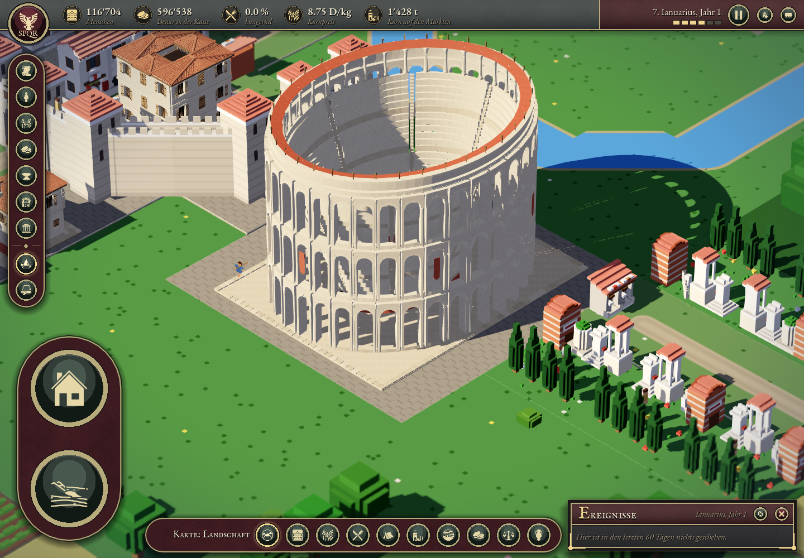
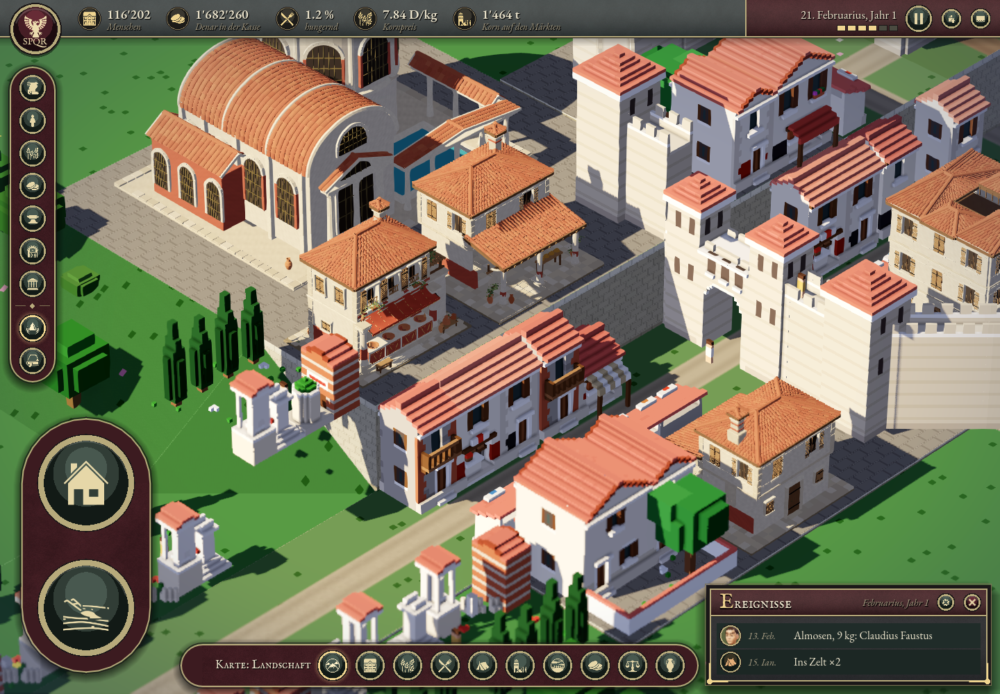
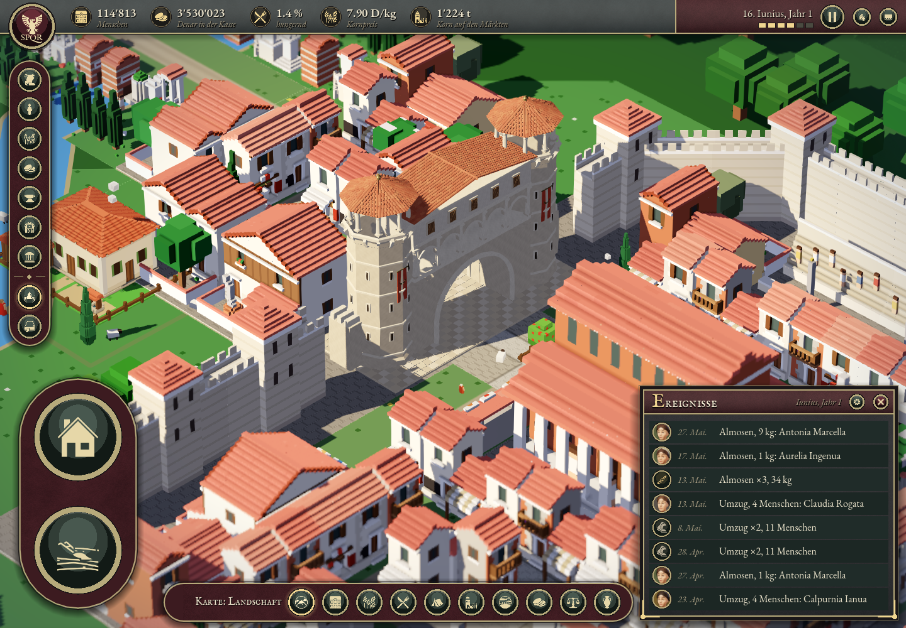
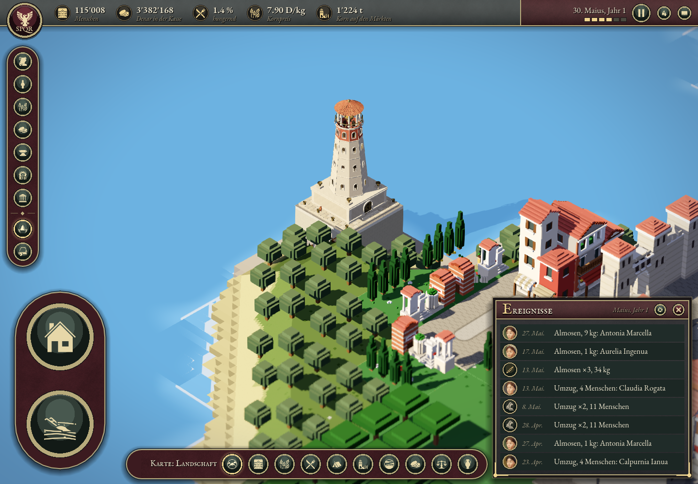
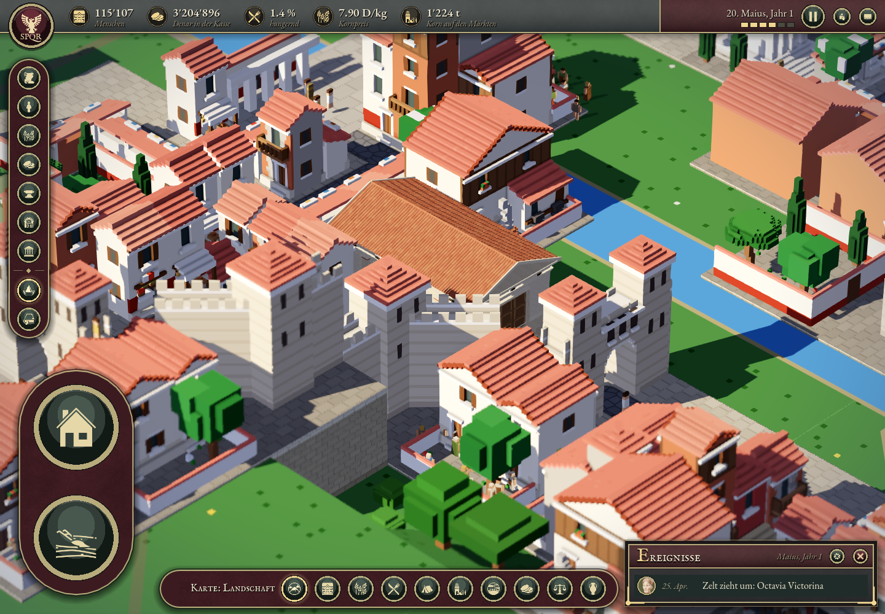

# Roman series – validation

Status: validiert am 1. November 2026, lokal auf Apple M3 Pro mit Godot 4.7.2 / Metal Forward+.

Alle 19 angeforderten zusätzlichen Modelle sind in der normalen Landscape-Szene installiert. Die bestehende Taverna bleibt erhalten. Dieser Nachweis dokumentiert die lokale Prüfung vor der Veröffentlichung.

## Automatischer Spieltest

Aufruf: `Godot --path app --script res://scripts/debug/roman_series_integration_check.gd`

Ergebnis: **19/19 installiert, 0 Fehler**, 1157 echte Spielframes; Laufzeit 22.532 s. Das ist ein funktionaler Rundgang und kein Leistungsbenchmark. Der Test lädt über die laufenden Spiel-Frames, besucht alle vier Städte und jedes Gebäude, wechselt Detailstufen bis 120 km Sichtbreite, schwenkt weg und kehrt zurück.

Geprüft: einheitlicher Massstab, vollständige Modellgrenzen innerhalb der reservierten Parzelle, Erhalt aller importierten Materialien/Texturen/Rauheit/Metall/Emission, genau eine sichtbare Geometriestufe, Unterdrückung der ersetzten Altmodelle, Übergabe an den entfernten Stadt-Renderer, wiederholter Stadtbesuch ohne doppelte Instanzen. Taverna: weiterhin 30 Materialien und 9 Texturen; ihre Nachbarparzelle trägt jetzt die Bäckerei.

257 Parzellen samt Umfeld unverändert. Der vollständige CPU-Stadtatlas und seine Seitentabelle bleiben bytegleich:

- Atlas SHA256: `fc17bb03b95d3418227ed77d4d5844e444b1a62758fd08768bd2f30ffc8d8748`
- Seitentabelle SHA256: `be7d63c08e2b6b57d7d1c20a7bee3e5c6c0c48ac2287c1891963687dcd822922`

Maschinenlesbarer Nachweis: `integration-report.json`. Screenshots aller 19 Modelle und der Taverna: `build/roman-series/integration/`. Der Prüflauf verändert keine gespeicherten Spiele.

## Platzierung und Durchfahrt

`build/verona-venv/bin/python -m unittest discover -s tools/tests -p test_roman_series_placements.py -v`: **10 Tests bestanden**. Enthält alle Atlaszellen, Überschneidungen, fünf exakte Verona-Rechtecke, Schutz der Taverna/des Forums/übriger bekannter Gebäude, Zugänge und Grössenanpassung. Die tatsächlichen GLB-Dreiecke des Stadttors wurden auf freie Fahrbahn in Detail und Medium geprüft.

`git diff --check`: bestanden. Godot-Import und GDScript-Kompilierung ohne Fehler.

## Bildprüfung und Grenzen

Siehe `visual-review.md`: 19 Vorderseiten, 19 Rückseiten und 19 mittlere Detailstufen. Ferngeometrie wird aus Qualitätsgründen nicht verwendet; Amphitheater, Theater und Thermen bleiben vollständig detailliert, die anderen 16 verwenden entfernt ihre mittlere Geometrie. Dies erhöht den Geometrieaufwand gegenüber einer späteren sauberen Fernoptimierung. Geladene Modelle bleiben beim Stadtwechsel im Speicher.

Die neuen Modelle stehen zwischen weiterhin vorhandenen älteren Voxelmodellen. Es ist die Einbindung dieser 19 Vorlagen, keine Ersetzung sämtlicher Häuser der Spielwelt. Künstlerische Standortannahmen und alle Parzellen sind in `docs/kit2/ROMAN_BUILDINGS.md` sowie im Manifest dokumentiert.

Die Direktstarts wurden bis zur normalen Landscape-Initialisierung geprüft. Eine zusätzliche Launcher-Aufnahme wurde wegen parallel laufender Godot-Fenster beendet; die vollständigen Spielaufnahmen stammen aus dem erfolgreichen Integrationstest.

## Versionierte Spielbilder

