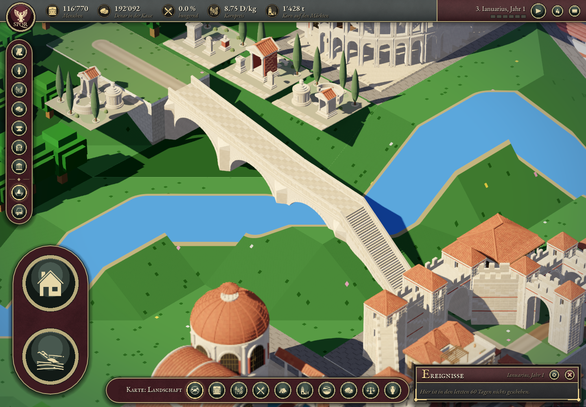
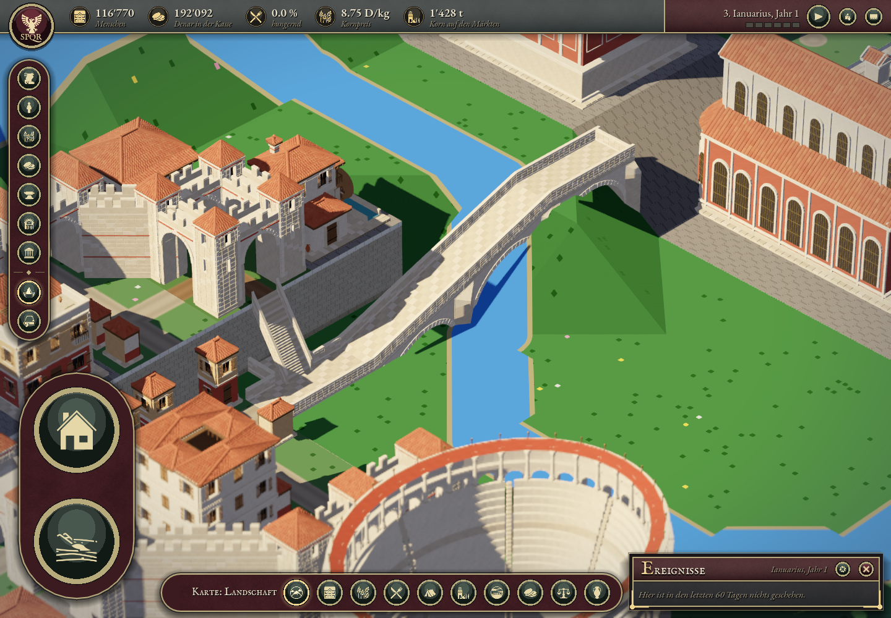

# Verona – Brückenprüfung

Status: validiert, 1. November 2026. Basis: `6c54a76391fddffe07026553b3861043d8fbeaa2` (PR #142).

Die beiden bestehenden Übergänge erhalten fünf eigene Steinbrückenbauteile in neun Instanzen. Ihre acht Parzellen, Verbindungen und Strassenränge bleiben unverändert. Massstab, Höhenprofile und die bewusst steilen Fusszugänge sind in [VERONA_BRIDGES.md](../../kit2/VERONA_BRIDGES.md) beschrieben.

## Ergebnis

Der finale Spieltest beendet sich regulär mit **0 Fehlern nach 495 Spielframes** auf Godot 4.7.2 / Metal Forward+ / Apple M3 Pro. Alle neun Instanzen sind geladen. 144 Strahlprüfungen bestätigen die realen Deckanschlüsse in allen drei Detailstufen. Die bisherigen 35 Gebäudegrenzen und 696 Prüfungen der Befestigungen bestehen unverändert. Stadtatlas und Seitentextur sind vor und nach dem Lauf identisch. Bericht: [final-report.json](final-report.json).

Alle zehn finalen Bilder wurden nach dem korrigierten Treppenexport aufgenommen. Die Brücken verwenden die Detailstufe bei 1.5 km, die Mittelstufe bei 5 km und die Fernstufe bei 12 km. Bei 24 und 60 km sind neue Meshes und Ersatzmaske ausgeschaltet; dort übernimmt die bisherige Landschaftsdarstellung. [Sichtprüfung](visual-review.md).

Der unabhängige Assetcheck besteht für **5 Assets / 15 LODs** mit 19'557 Dreiecksstrahlen und 30 Volumenprüfungen, ohne Fehler. Der kombinierte Treppenantritt wird zusammen mit dem Abzweigdeck geprüft. Bericht: [asset-validation.json](asset-validation.json). Alle fünf Fallbackfälle bestehen ebenfalls: [fallback-report.json](fallback-report.json). Godot-Import und Reimport melden keine Fehler oder Warnungen; die zehn bestehenden Platzierungstests bestehen.

Der abschliessende Rundgang durch die ursprünglichen 19 Modelle besteht ebenfalls mit **0 Fehlern nach 1'157 Spielframes**, normalem Prozessende, 90 geladenen bisherigen Serieninstanzen und unveränderter Taverna mit 30 Materialien / neun Texturen. Stadtwechsel und Rückkehr sowie alle bestehenden Detailstufen wurden dabei geprüft. Die neun Brückeninstanzen gehören zur separaten Brückenklasse. Bericht: [series-regression.json](series-regression.json).





## Prüfverfahren

- Die Spielprüfung startet die normale Landschaft mit Metal Forward+, pausiert die Simulation und nimmt beide Brücken, ihre Anschlüsse sowie fünf Stadtansichten auf. Wetter ist für die Sichtkontrolle ausgeschaltet. MSAA 4× und der zuletzt akzeptierte Schattenversatz bleiben erhalten.
- Der Test übernimmt die bisherigen 35 Gebäudegrenzen und die 696 Dreiecksprüfungen der Mauern und Tore. Zusätzlich prüft er die Brückenanschlüsse in allen drei Detailstufen, einschliesslich des shaderseitigen Höhenversatzes. Die drei äusseren Fahrbahnanschlüsse werden mit der tatsächlichen HDR-Eckentextur des Spiels verglichen.
- Strahlen werden in Modellmetern gerechnet. In Welt-km unterschreiten kleine Detaildreiecke die feste Epsilon-Schwelle von `Geometry3D.segment_intersects_triangle`; dies erzeugte im ersten Test falsche Fehlmeldungen ausschliesslich im Detail-LOD. Die Korrektur betrifft die Prüfmethode, nicht die Brückengeometrie.
- Der unabhängige Python-Validator untersucht die exportierten Dreiecke ohne Godot: Bogenlöcher, geschlossene Decks, freie Fahrbahnbereiche, Brüstungen, Enden, waagerechte Tritte und alle drei Detailstufen.
- Der headless Fallbacktest prüft fehlende Assets, fehlende und leere LODs, einen Fehler während der Gruppeninstallation sowie den Wechsel in die Ferne und zurück. Kein unvollständiges Assembly darf den bisherigen Terrassenkörper ersetzen.
- Atlas und Seitentextur werden vor und nach dem Spieltest gehasht. Die zehn bisherigen Platzierungstests laufen zusätzlich unverändert.

## Behobener Befund

Beim separaten steilen Treppenzugang ragte die geneigte Stringeroberkante durch einzelne waagerechte Tritte. Der unabhängige Validator fand dies über die tatsächliche obere Dreiecksfläche. Die Oberkante des Unterbaus wurde von −0.10 m auf −0.24 m relativ zum Neigungsprofil abgesenkt. Stufen, Anschlüsse und die vier anderen Brückenassets bleiben unverändert.

Zusätzlich lag der unterste Tritt deckungsgleich auf der andersfarbigen Bodenfläche des Abzweigs. Diese doppelte Oberfläche entfällt; das vorhandene Abzweigdeck bildet den unteren Antritt. Die kombinierte Geometrie wird auf eine durchgehende Lauffläche geprüft.

## Grenzen der Darstellung

Der vorhandene Stadtplan und die Geländestufen erzwingen zwei Treppenabschnitte. Sie werden als Fusszugänge gezeigt; die Darstellung ist keine Behauptung einer befahrbaren historischen Brücke. Der kurze nördliche Zugang der Ostbrücke bleibt besonders steil. Der niedrige Abzweig ist ein Widerlager; nicht jeder Bogen ist über dem Wasser vollständig frei. Grüne Uferflächen unter Bögen gehören zum bestehenden Flussbett und werden nicht durch erfundenes Wasser ersetzt.

Die Modelle sind eigene römische Bautypen. Die Runde verändert weder Simulation noch geografische Daten und erhebt keine Behauptung über eine konkrete historische Bauphase. Es werden keine Leistungsgewinne aus den Sichtprüfungen abgeleitet.

## Reproduzieren

```sh
Blender --background --factory-startup --python tools/buildings/build_verona_bridges.py -- --all
Godot --headless --path app --editor --import
build/verona-venv/bin/python tools/tests/check_verona_bridge_assets.py
Godot --headless --path app --script res://scripts/debug/verona_bridge_fallback_check.gd
Godot --path app --script res://scripts/debug/verona_bridges_check.gd -- --phase=final --weather=off
build/verona-venv/bin/python -m unittest discover -s tools/tests -p test_roman_series_placements.py
```

Die GLB-Importdateien setzen `meshes/generate_lods=false`. Der vollständige Spieltest benötigt den normalen Renderer; headless genügt nur für den Fallbacktest.
