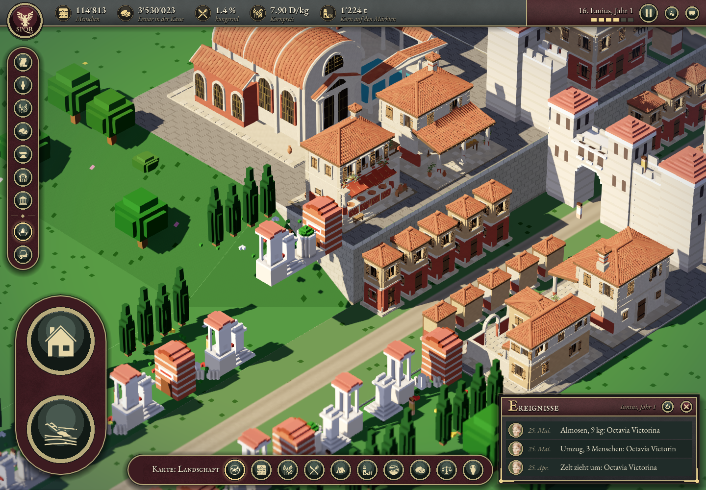
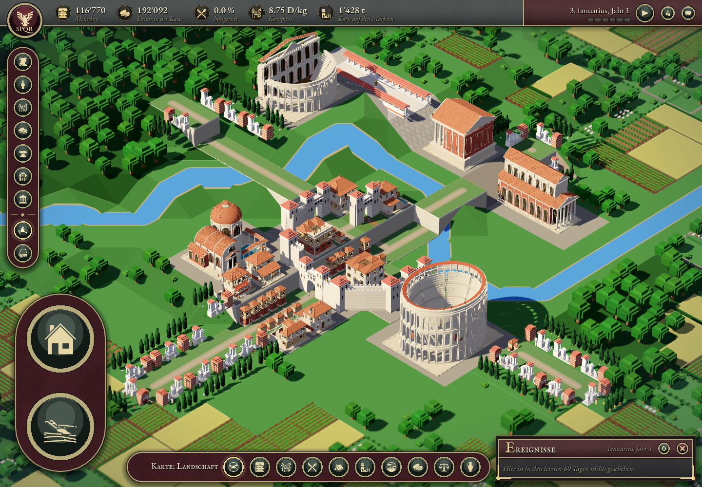

# Verona – Prüfung der fertigen Einbindung

Status: validiert am 1. November 2026, lokal auf Apple M3 Pro mit Godot 4.7.2 / Metal Forward+.

Alle acht bestehenden Wohnparzellen verwenden eigene Modelle. 23 zusätzliche Strassenhäuser wurden einzeln ersetzt, einschliesslich der niedrigen Läden auf der Kameraseite. Der Stadtatlas und die Simulation bleiben unverändert. Mauern, Tore, Forum, Gräber und Verkehrswege behalten die bisherige Darstellung; diese Runde vereinheitlicht Wohn- und Geschäftsgebäude.

## Ergebnisse

- Verona-Test: **0 Fehler**, 35 Serieninstanzen in Verona inklusive Monumenten und 23 Strassenstücken; die separat geladene Taverna bleibt erhalten.
- Acht Wohnparzellen ohne alte Wohnhaus-Meshes; alle 23 Strassenstücke einzeln ersetzt, kein Strassenfeld vollständig reserviert.
- Tatsächliche Mesh-Grenzen in den Parzellen, Fahrbahnen frei, Höhenkappen eingehalten; derselbe Asset-Mesh wird von mehreren Instanzen geteilt.
- Angeforderte und sichtbare Detailstufe stimmen bei jeder geprüften Breite überein. Genau eine Stufe sichtbar; Rückkehr zur alten Darstellung bleibt bei fehlendem Ersatz möglich.
- Vollständiger Stadtatlas und Seitentabelle bytegleich; keine Loader-Fehler.
- Nach dem letzten kompatiblen Detail-Export erneuter Rundgang durch alle 19 ursprünglichen Gebäude: **0 Fehler**, 1170 echte Spielframes, alle 45 Serieninstanzen geladen, Taverna weiterhin 30 Materialien / 9 Texturen. Dieser Lauf bestätigt die endgültigen Binärdateien; die Verona-Messung davor unterscheidet sich nur in der wiederhergestellten Original-Detailtessellierung der sechs älteren Hausmodelle.
- Zehn ursprüngliche Parzellen-/Tor-Durchfahrtstests bestanden; Godot-Import/Kompilierung und `git diff --check` fehlerfrei.

## Formbewahrende Geometrie

Alle 19 ursprünglichen Detailmodelle haben exakt dieselben POSITION-/Indexpuffer wie vor der Umstellung. Ihre mittleren Modelle enthalten zusammen 375'597 statt 1'493'375 Dreiecke (25,2 %); die Fernmodelle 180'357 (12,1 %). Bögen, Dachflächen und Kuppeln wurden in expliziten Medium-/Far-Aufnahmen geprüft. Auch alle fünf neuen Varianten sind in Detail/Far geprüft. Keine Exportwarnungen oder ungültigen Geometriepuffer.

## Darstellung und Leistung

Alle fünf Spielansichten wurden geöffnet und geprüft. Sichtbare Eingänge und Fahrbahnen sind frei, keine neuen schwebenden Fundamente oder Löcher beobachtet. Bestehende hohe Mauern verdecken einzelne Kontaktstellen; für diese gelten zusätzlich die geometrischen Grenzenprüfungen. Nah bleiben feine Schatten-/Ziegelmuster sichtbar.

Die Messungen bei 1440×1000 und pausierter Simulation lagen im finalen Lauf bei rund 9–14 ms medianer Framezeit. Die Vorhermessung lief unter anderer Rechnerauslastung; daraus wird **keine prozentuale FPS-Steigerung** abgeleitet. Die Nahansicht zeichnet mehr Details und mehr Draw Calls. Die weiteren Ansichten brauchen weniger Primitive. GPU-Zeit wurde vom Backend als 0 gemeldet und ist nicht auswertbar. Der volle Vergleich steht in `visual-review.md`; Rohwerte in `baseline-report.json` und `final-report.json`.

## Reproduzierbare Befehle

```
Godot --headless --path app --editor --import
Godot --path app --script res://scripts/debug/verona_city_check.gd -- --phase=final
Godot --path app --script res://scripts/debug/roman_series_integration_check.gd
build/verona-venv/bin/python -m unittest discover -s tools/tests -p test_roman_series_placements.py -v
```

`lod-validation.json` enthält die 19 Geometriehash-Vergleiche. `series-regression.json` enthält den abschliessenden Rundgang. Die Blender-Generatoren und Spielstarts sind in `docs/kit2/VERONA_CITY.md` beschrieben.




