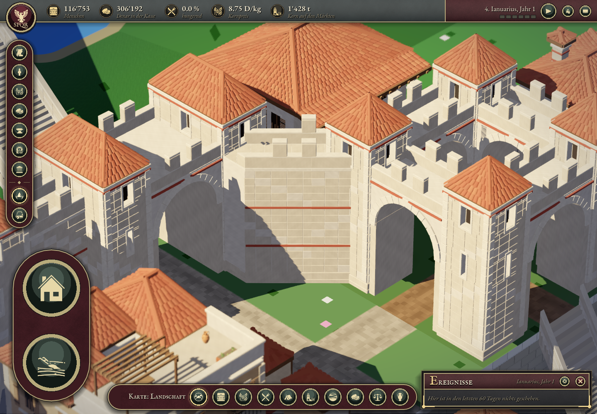

# Verona – sichtbarer Abstand der Zinnen zu den Türmen

Die erneute Nutzerkorrektur lautete ausdrücklich: „die zinnen der mauer gehen direkt rein in den turm“. Der vorherige Fassadenschnitt aus PR #144 behob Innenraumüberschneidungen, liess aber angeschnittene Zinnen unmittelbar an den diagonalen Turmflächen stehen. Seine visuelle Entwarnung war für diesen Befund nicht ausreichend.

## Änderung

Die hochstehenden Zinnenkörper samt Decksteinen werden jetzt nur als ganze Bauteile erzeugt, mit mindestens **0.60 m Abstand zur sichtbaren Turmkante**, einschliesslich 0.07 m vorstehender Ecksteine. Zinnen, deren vollständiger Grundriss diesen Abstand unterschreitet, entfallen. Die geometrischen V-/Keilschnitte schneiden keine Zinnen mehr an.

Betroffen sind die diagonalen Mauer-/Toranschlüsse. Die niedrige Brustwehr und der Wehrgang bleiben konstruktiv mit den Türmen verbunden. Weder Turmhöhen noch Grundriss oder Gelände wurden verändert. Die torbogeneigenen Zinnen wurden separat geprüft; ihr bestehender Abstand genügt bereits. Beide Torhäuser und der einzelne Turm bleiben bytegleich. Alle Nicht-Zinnen-Flächen bleiben in allen drei Detailstufen gleich: [Quellenvergleich](source-geometry-validation.json).

## Nachweis

Der neue unabhängige Test liest die tatsächlichen GLB-Dreiecke. Er prüft den äusseren Abstand zur Turmhülle statt nur das Freibleiben des Innenraums und prüft zusätzlich vollständige Körper/Kappen. Die ursprünglichen Assets reproduzieren 18 Abstandsbefunde (sechs diagonale Instanzen × drei Detailstufen), 24 Formbefunde und sechs Grundrissbefunde. Mehrere dieser 48 Meldungen betreffen denselben angeschnittenen Block. Die Torbogen-Zinnen werden ebenfalls erfasst. [Baseline-Bericht](baseline-validation.json).

Die finale Geometrie besteht 546 Abstands-Volumenprüfungen, davon 30 für torbogeneigene Zinnen, ohne Fehler. [Finaler Bericht](merlon-validation.json). Der bestehende Befestigungsvalidator besteht weiterhin 495 Endflächen- und 270 Durchgangsstrahlen. Der normale Spieltest beendet sich nach 482 Frames regulär mit null Fehlern; er prüft zusätzlich die bisherigen Gebäudegrenzen, Mauer- und Brückenanschlüsse und unveränderte Atlas-/Seitentexturen. [Spielbericht](game-report.json), [unabhängiger Nahbildvergleich](visual-review.md).

Die gezielten Nahbilder verwenden vor und nach der Änderung dieselbe Kamera mit auf die Mauerkrone angehobenem Fokus. Keine Modelle wurden ausgeblendet. Die Aussage dieser Runde betrifft den sichtbaren Rücksprung der hochstehenden Zinnen; sie ist keine pauschale Abnahme sämtlicher Architekturdetails.

Vorher:


Nachher:



## Reproduzieren

```sh
Godot --headless --path app --editor --import
Godot --path app --script res://scripts/debug/verona_wall_joins_check.gd -- --phase=merlon-after --weather=off
build/verona-venv/bin/python tools/tests/check_verona_merlon_clearance.py --runtime-report build/verona-wall-joins/merlon-after/report.json
build/verona-venv/bin/python tools/tests/check_verona_fortification_assets.py
```
