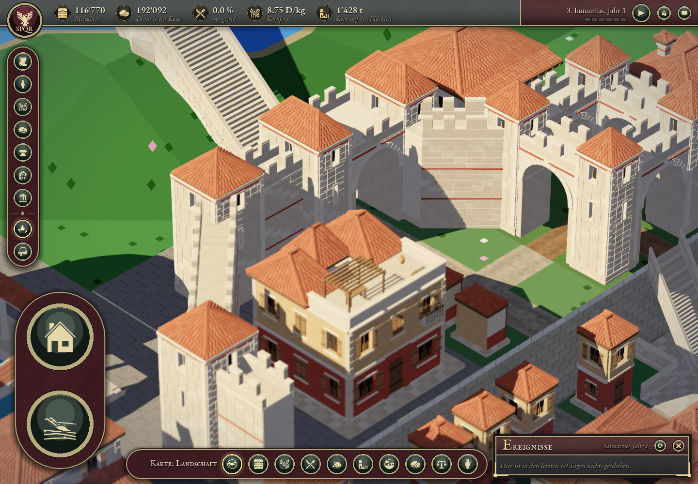
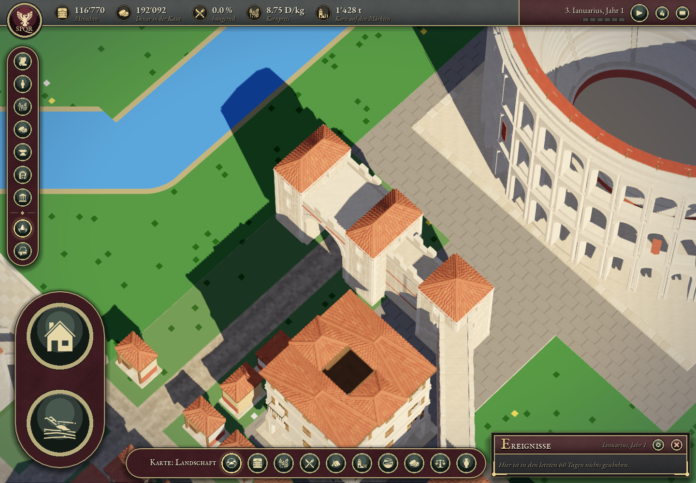

# Verona – Mauerenden an Türmen und Toren

Status: validiert. Ausgangsstand: `a7bc55d2639b8d508911df4de8c326522beb62a1`.

Der Nutzer meldete Mauerstücke, die in Türme hineinlaufen. Die bisherigen Prüfungen deckten Strassendurchgänge und die Verbindung zweier Mauerarme zwischen Parzellen ab, aber nicht deren Eindringen in die hohlen Turmkörper. Diese Lücke in der Prüfung wird hier ausdrücklich geschlossen.

## Reproduzierter Fehler

Die geraden und diagonalen Mauerarme begannen bisher bei −1.15 Modellmetern relativ zum Turmzentrum. Die Toranschlüsse begannen bei 3.50 m, innerhalb der seitlichen Torpavillons. An den aktuellen vier Mauerparzellen und vier Toren ergibt der unabhängige Test **42 Befunde in 588 Dreieck-/Volumenprüfungen**: alle 14 Anschlussstücke drangen in jeder der drei Detailstufen in den jeweiligen Turminnenraum ein. [Baseline-Befunde](baseline-join-validation.json), [reale Instanzpositionen und GPU-Höhen](baseline-report.json).

## Korrektur

Vier bisherige Anschlussassets werden korrigiert; für das diagonale Kreuzungstor kommt ein eigenes Anschlussasset hinzu. Türme, Tore, Dächer, Häuser, Brücken und Grabparzellen bleiben geometrisch unverändert. Es werden keine Turmkörper verschoben oder vergrössert, um die Durchdringung zu verdecken.

- Gerade Mauerarme enden an der Turmfassade bei 1.83 m.
- Diagonale Mauerarme erhalten einen geschlossenen V-Schnitt entlang beider Turmflächen.
- Gerade Toranschlüsse beginnen an der äusseren Pavillonfassade bei 4.88 m.
- Der diagonale Anschluss am normalen Tor erhält einen Keilschnitt entlang der südlichen Fassade und ihrer inneren Seitenkante. Dadurch bleibt kein loses Wandstück vor dem Tordurchgang stehen.
- Der diagonale Anschluss am Kreuzungstor erhält ein eigenes V-Profil für dessen Eckpavillon (`verona_gate_crossing_diagonal_link`).

Die Schnittflächen werden geometrisch geschlossen, einzeln pro konvexem Steinbauteil und in jeder Detailstufe neu erzeugt. Massstab und äussere Anschlussenden zwischen den Parzellen bleiben gleich. Die Laufzeit wählt das zum Tor passende Profil. Falls ein künftiger Mauerpunkt keinen zentralen Turm besitzt, bleiben dort die vollständigen bisherigen Mauerstücke aktiv; die gekürzten Arme werden dort nicht eingesetzt.

## Prüfung

Die finale Fassung besteht **588 Dreieck-/Volumenprüfungen und 48 Strahlen an den tatsächlichen Geländeanschlusshöhen ohne Fehler**. Vorher waren 42 Durchdringungen nachweisbar. [Finaler Geometriebericht](join-validation.json).

Der Endflächenvalidator besteht für acht Befestigungsassets mit 495 analytisch berechneten Anschlussstrahlen und 270 weiterhin freien Tordurchgangsstrahlen. [Assetbericht](asset-validation.json). Alle fünf gezielten Fälle der Laufzeitauswahl bestehen: [Variantenbericht](runtime-variant-check.json).

Der finale Spieltest beendet sich regulär mit null Fehlern: 35 bisherige Gebäudegrenzen unverändert, 696 bisherige Befestigungsprüfungen und 144 Brückenanschlussprüfungen bestanden, identische Atlas-/Seitentexturen. [Spielbericht](final-report.json). Die drei bestehenden Turm-/Tormodelle bleiben per SHA256 identisch; vier Anschlussmodelle wurden geändert und eine Variante ergänzt. [Erzeugungsbericht](generation-report.json).

Alle acht Mauer-/Torknoten wurden im Spiel geprüft. Für das von der Arena verdeckte südliche Tor gibt es zusätzlich eine erhöhte Gegenansicht mit 65° Neigung; dabei wurde kein anderes Modell ausgeblendet. [Unabhängige Sichtprüfung](visual-review.md).





`check_verona_wall_tower_joins.py` liest tatsächliche GLB-Dreiecke und den Instanzdump des normalen Spielrenderers. Es prüft jeden Mauerarm gegen sämtliche Turminnenräume – auch auf Nachbarparzellen und unter Berücksichtigung der echten GPU-Geländehöhen. Die Volumenprüfung erkennt auch Dreiecke, deren Eckpunkte ausserhalb eines Innenraums liegen, deren Fläche ihn aber durchschneidet. Die alte Fehlerfassung ist im Baseline-Bericht nachgewiesen.

Der bestehende Assetvalidator prüft weiterhin echte geschlossene Endflächen. Bei V- und Keilschnitten berechnet er deren erwartete Position für jede Querposition analytisch; die Prüfungen wurden nicht entfernt. Die bestehenden Tordurchgangsprüfungen bleiben erhalten. Der gezielte Laufzeittest deckt die Variantenwahl und den Rückfall für Knoten ohne Turm ab.

Die Spielprüfung nimmt alle acht Mauer-/Torknoten aus der normalen Spielkamera auf. Sie übernimmt zusätzlich die bisherigen Prüfungen der 35 Gebäudegrenzen, der Befestigungen, der Brückenanschlüsse sowie der unveränderten Atlas-/Seitentextur.

## Reproduzieren

```sh
Godot --headless --path app --editor --import
Godot --headless --path app --script res://scripts/debug/verona_wall_join_variants_check.gd
Godot --path app --script res://scripts/debug/verona_wall_joins_check.gd -- --phase=final --weather=off
build/verona-venv/bin/python tools/tests/check_verona_wall_tower_joins.py
build/verona-venv/bin/python tools/tests/check_verona_fortification_assets.py
```
