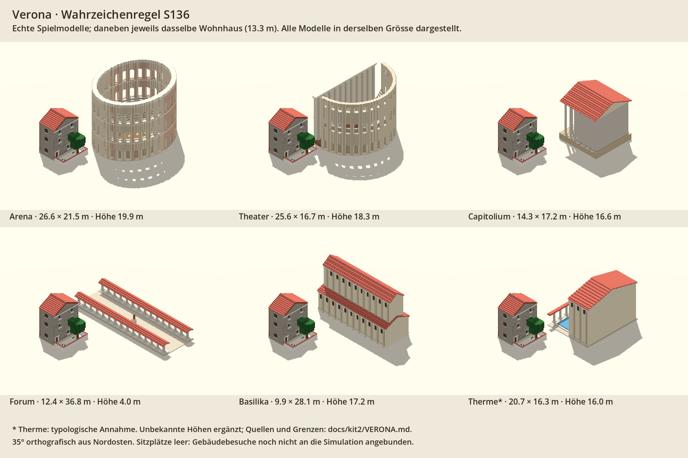
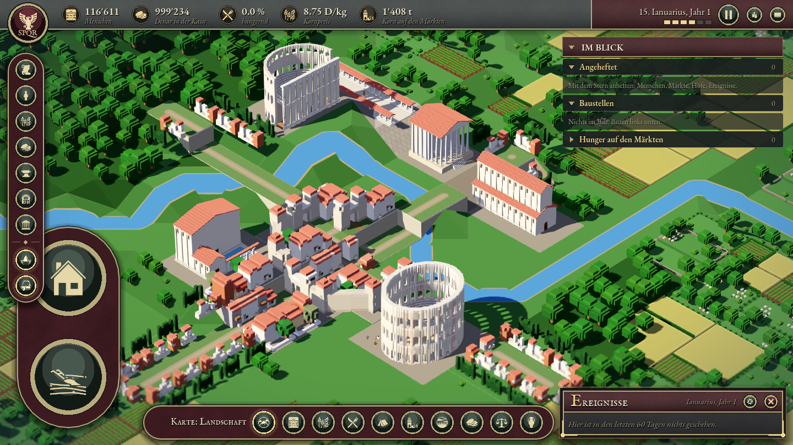

# Verona-Prüfung, 31.10.2026

**Status: technisch validiert; visuelle Referenz zur Abnahme.**
Ausgangspunkt: `c08d06dadd295a8cd8c304ebdb56ea7c9f30b5e7` (PR #138).
Godot 4.7.2, Metal, Apple M3 Pro. Bestehende Rust-Bibliothek unverändert.

- Vollständiger Bake vor der Änderung reproduzierte den eingecheckten Atlas,
  alle Stadtmetadaten und die Wohnplatzdatei exakt.
- Nach der Änderung: nur Veronas Metadaten geändert; 63 Atlastexel geändert,
  sämtlich innerhalb von Veronas Planrechteck. Seiten-/Slotbelegung gleich.
  Alle 859 anderen Städte und ihre Wohnplatzdatensätze unverändert.
- Vier automatisierte Tests bestanden: sechs vollständige Gebäude-Blöcke;
  keine Wasserbelegung oder Überlagerung des geschützten Wohnkerns;
  genug Parzellen für unskalierte Modelle; deterministischer Bake und
  keine Aktivierung dieser Modelle durch Namensgleichheit in anderen Städten.
- Messung aus echten Godot-Meshes: Höhe Arena 20.02 m, Theater 18.27 m,
  Capitolium 16.77 m, Forum 4.26 m, Basilika 17.27 m, Therme 16.01 m.
  Vergleichshaus: 13.27 m. Kleine Abweichungen zur Formel sind Voxelrundung
  und Abschlussdetails, siehe `VERONA.md`.
- Sechs Spielaufnahmen: Verona 6/2/3 km, Rom 5 km, Verona 18 km und zurück
  auf 6 km. Keine Script-, Shader- oder Assertion-Fehler. Die bereits vor
  der Änderung vorhandene Warnung über zwei ObjectDB-Instanzen am Ende
  bleibt bestehen.
- Rom visuell mit Ausgangsaufnahme verglichen. Unterschiedliche
  Fensterauflösung und fortlaufende Simulation: **kein pixelgleicher
  Regressionstest**. Die Rom-Modelle wurden nicht verändert.
- Kein neuer Performance-Gewinn behauptet. Dies ist ein Lauf-/LOD-Test,
  kein kontrollierter Leistungsmesslauf.

Die Quellenlage und der historische Plan sind nicht vollständig validiert.
Insbesondere Therme, unbekannte Höhen und verschobene öffentliche Blöcke
sind ausdrücklich dokumentierte Annahmen.

Lokale Rohdaten im Arbeitsverzeichnis: `build/verona/` (Logs/Bakes),
`.impeccable/review/` (Aufnahmen). Erzeugbar mit den Befehlen in
`docs/kit2/VERONA.md`; die Bilddateien sind Review-Artefakte, keine Spielassets.

## Visuelle Abnahme des Referenzstands

Unabhängige Impeccable-Finish-Prüfung: **ship**, keine materiellen Korrekturen. Geprüft wurden fünf Aufnahmen (Modellvergleich, Spielübersicht, Nahansicht, fernere LOD, Rom). Statisches Urteil zu Form, Material, Lesbarkeit und sichtbarer Platzierung; keine historische oder Performance-Zertifizierung. Dokumentationsprüfung abgeschlossen, bestehende Gestaltung beibehalten.

