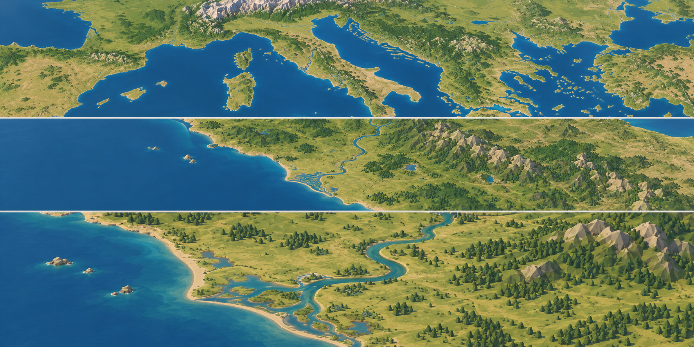
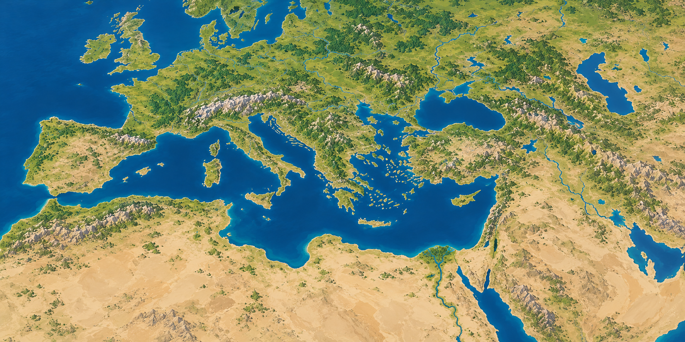

# Landschaftsstil: akzeptierte Bildreferenzen

**Referenzversion:** `kit1-landscape-v5` · **Dokumentationsstand:** 25.10.2026.  
**Status:** Nutzerakzeptierte Stilrichtung `spezifiziert`; Umsetzung und Laufzeitprüfung `offen`.

Die Nutzeranlage steht hierarchisch an erster Stelle und präzisiert die frühere,
zu stark voxelartige Stilbeschreibung. Sie legt Palette, Materialwirkung und
Detaildichte der natürlichen Landschaft fest; sie liefert keine Geodaten,
Laufzeitbilder, historische Rekonstruktion oder technischen Belege. Die drei
offiziellen Urbek-Screenshots bleiben als getrennte Quellenreferenzen
erhalten, unterliegen aber der Nutzer-Primärreferenz. Frühere eigene generierte
Stilproben und eine neu erzeugte Nahprobe wurden aus dem aktuellen Kit entfernt.
Eine neu erzeugte Fernprobe ist nur als ergänzende Stilreferenz aufgenommen; sie
definiert nicht den flachen Fernkartenendpunkt. Weitere Bildgenerierung ist nicht
beauftragt. Gesamtregion und Zoomanforderungen bleiben unverändert.

## Nutzer-Primärreferenz

### Primärreferenz — vom Nutzer bereitgestellte Landschaftsfolge

**Nutzerbewertung:** „ich muss sagen das gefällt mir am besten: wenn es so rauskommen würde wär wunderschön. nicht zu bunt aber dennoch extrem wunderschön. das wär für mich die referenz. nicht zu low polig“ (25.10.2026).

**Meine Sichtung:** Die drei horizontalen Bildstreifen zeigen ein stilisiertes,
nicht fotorealistisches Landschaftsbild mit gemäßigtem Grün, tiefblauem Meer und
helleren Flachwasserzonen. Helle graubeige, facettierte Gebirge kontrastieren mit
lesbaren Waldgruppen. Geländeformen sind erkennbar facettiert, bleiben aber
natürlich verbunden; Bäume und Gelände wirken nicht wie starre Würfel. Die
Komposition bleibt detailliert und ruhig, statt extrem bunt oder übermäßig
low-poly zu wirken.

**Verbindliche Stilmerkmale:** Dies ist die primäre Referenz für natürliche
Terrainpalette, Materialwirkung und Detaildichte: zurückhaltende, nicht zu bunte
natürliche Farben; gut lesbare, facettierte Formen mit genügend Landschaftsdetail;
natürliche Übergänge; stilisierte Gamegrafik ohne Fotorealismus. Sie ersetzt die
frühere Forderung nach voxelartigen, klotzigen oder extrem low-poly Formen.
Sie gibt keine Polygonbudgets, Renderleistung oder Hardwarefähigkeit vor.

**Grenzen:** Das Bild ist keine Datenquelle, Höhenmessung, reale Küsten-/Fluss-
oder Reliefgeometrie, Maskengeometrie, historische Landschaft für 117/180 n. Chr.
oder Beleg einer tatsächlich zoomenden gemeinsamen Szene. Einzelne Baumgruppen
bleiben eine mögliche Darstellung belegter Landcoverklassen, keine behauptete
Standortmessung einzelner Bäume. Das obere Panel definiert nicht den flachen
2D-Fernkartenendpunkt; dieser Scope bleibt bestehen.

**Provenienz:** vom Nutzer am 25.10.2026 als Anhang bereitgestellt; unverändert
übernommen. Der individuelle Urheber und eine externe Lizenz sind nicht
festgestellt. Portable Datei, Hash, Größe und native PNG-Metadaten stehen in
[`sources.json`](images/sources.json); ein lokaler Quellpfad wird nicht gespeichert.

## Ergänzende Fernstilreferenz

Diese auf Basis der Primärreferenz erzeugte Fernprobe wurde vom Nutzer am
25.10.2026 als Stilreferenz akzeptiert: „doch weitsicht ist okay“ und „aber na
gut“. Der Nutzer wies zugleich darauf hin, „auch wenn die flach sein sollte“.
Damit gilt das Bild nur als ergänzende Stil-/Farbprobe für die weiträumige Ansicht;
es belegt **nicht** die geforderte flache 2D-Kamera und macht Relief, Schatten oder
Höhenprominenz nicht verbindlich. Der fernste tatsächliche Kartenendpunkt muss
flach 2D sein.

## Abgelehnte Nahprobe

Eine auf Basis der Primärreferenz erzeugte Nahprobe wurde dem Nutzer ebenfalls am
25.10.2026 gezeigt und verworfen: „vor allem die nahaufnahmen finde ich nicht so
cool.“ Sie wurde aus Kitdateien, Stilguide, Quellenmanifest, Inventar und aktiven
Bildlinks entfernt. Ihr privates Generierungsoriginal außerhalb des Kits wurde
nicht gelöscht. Die Nutzer-Primärreferenz bleibt die Haupt- und Nahstilreferenz.

## Gemeinsame Abgrenzung

Die Stilreferenz beschreibt weiterhin **eine** Landschaftsansicht: flache
Fernkarte, zoomgebundener Übergang und nahe isometrische Diorama-Ansicht. Die
vorgegebenen Stilmerkmale ändern weder die Zoomsequenz noch den Umfang. Städte,
Gebäude, Menschen, GUI, Raster und sichtbare Tiles sind keine übertragbaren Inhalte.
Flache Ferne und räumliche Nähe müssen später aus derselben quellengebundenen
Geografie entstehen; die Bilder beweisen diese Konsistenz nicht.

Der geografische Gesamtumfang und die ADM2-Auswahlmethode bleiben unverändert:
gesamte Projektregion nach dem Bezugsrahmen um 117 n. Chr., gesamtes Mittelmeer,
England und nördlicher Kontext; moderne ADM2-Auswahlanker bleiben methodische
Orientierung, keine historischen Grenzen. Die Referenzbilder legen keine
Regiongrenze oder Auswahlmethode fest.

Vor einer späteren Bild-/Rendererprüfung sind die lokale Primärreferenz, die
nachrangige Fernstilreferenz und der
[Katalog der sechs echten Spiel-Screenshots](screenshots/README.md) tatsächlich
zu betrachten. Nur die hier beziehungsweise im Katalog ausdrücklich zugeordneten
Stilmerkmale dienen als Referenz; Provenienz und alle Ausschlüsse sind mitzulesen.

## Dateitreue und portable Provenienz

Die Primärreferenz und ergänzende Fernstilreferenz wurden als Bytekopien in dieses
Kit übernommen, ohne Beschneidung, Neukodierung oder Bildbearbeitung.
`sources.json` bindet die lokalen Kitpfade an
SHA-256, Dateigröße, PNG-Abmessungen, Farbtiefe und Farbtyp. Die Provenienz benennt
den Nutzeranhang beziehungsweise die eingeschränkte Nutzerakzeptanz, enthält aber keine
lokalen Home-/Privatpfade. Sie beansprucht keine externe Bildlizenz und keine
Nutzungsrechte jenseits der im Kit dokumentierten internen Stilreferenz.
