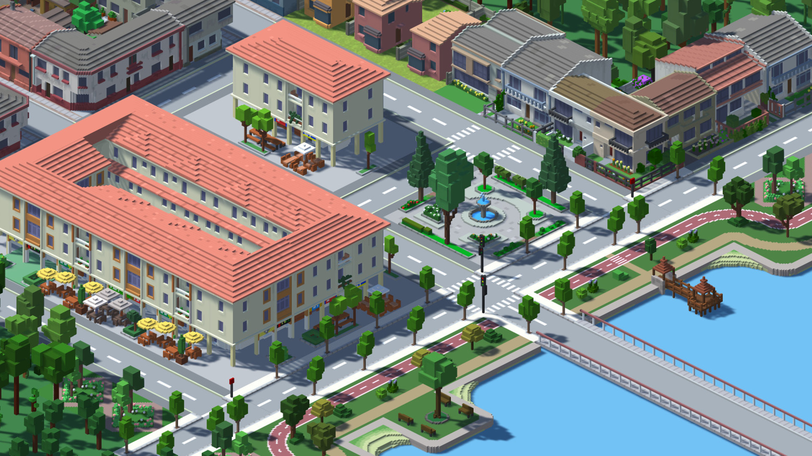
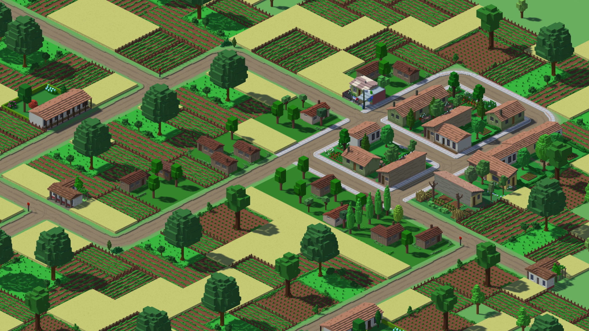
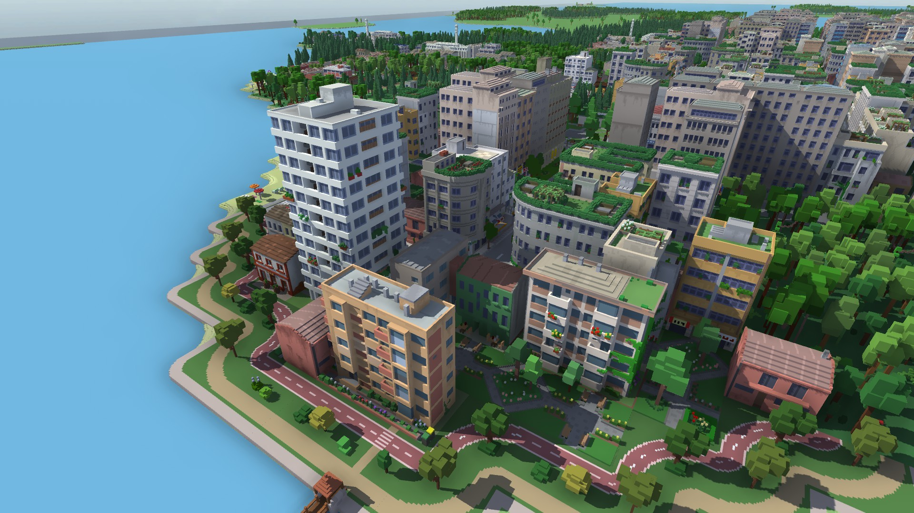

# Echte Spiel-Screenshots — Grafikreferenzen für Kit 1

**Stand:** 25.10.2026 · **Referenz:** `kit1-landscape-v5`, Ergänzung `screenshots-v1`.  
**Status:** Herkunft und sichtbare Bildeigenschaften `erforscht`; Zuordnung zu den
bereits bestätigten Vorgaben `spezifiziert`. Keine Spielimplementierung.

Sechs tatsächliche, von den jeweiligen offiziellen Steam-Shop-Galerien angebotene
Spiel-Screenshots sind lokal enthalten: drei aus **Urbek City Builder**, drei aus
**Victoria 3**. Es sind unveränderte JPG-Dateien aus den dort als `screenshots`
geführten Bildlisten, keine KI-Bilder, keine Trailer-Standbilder und keine selbst
aufgenommenen Kit-1-Laufzeitbilder. Alle sechs gelieferten Dateien wurden visuell
betrachtet. Der genaue Spielbuild und der individuelle Screenshotautor sind von
den Quellen nicht angegeben.

## Was die Referenzen leisten

Die IDs K01–K16 beziehen sich auf [die bestätigten Entscheidungen](../../decisions.md).
Die vom Nutzer bereitgestellte Landschaftsreferenz im
[STYLE_GUIDE](../STYLE_GUIDE.md) bestimmt Palette, Materialwirkung und
Detaildichte. **Urbek bleibt nachrangiger Kontext für vereinfachte Formen;
Victoria 3 veranschaulicht geografische Übersicht und räumliche Ausschnitte.**
Urbek-Formen bleiben gegenüber der Nutzer-Primärreferenz nachrangig.
Die Katalogzuordnungen sind illustrative Quellenbeobachtungen, keine
eigenständigen ästhetischen Anforderungen. Bei jeder Stilabweichung hat die
Nutzer-Primärreferenz Vorrang.

Die sechs Bilder sind **keine maßstabsgetreue Zoomsequenz desselben Ortes**.
Insbesondere zeigen sie keinen kontinuierlichen Übergang, keine feste Kamera
über die Zeit und keine geografische Konsistenz zwischen LOD-Stufen. Diese
Eigenschaften müssen später in Kit 1 durch echte zusammenhängende Aufnahmen und
Messungen geprüft werden. Die sechs Referenzbilder und ihre Zuordnung wurden nach der direkten
Darstellung im Chat vom Nutzer akzeptiert (25.10.2026). Diese Akzeptanz betrifft
die Referenzrichtung; sie ist keine Freigabe der späteren Kit-1-Grafik.

| Bild | Übertragbare Eigenschaft | Vorgaben |
|---|---|---|
| U01 — Urbek — kantige Nahansicht | Nachrangiger Kontext für klare Silhouetten und einfache Formen; nicht maßgeblich für die aktuelle Terrain-Detaildichte | K03, K08, K09, K10 |
| U02 — Urbek — Vegetation und lesbare Flächen | Die Baum-Silhouetten, reduzierte Oberflächenwirkung und Trennung größerer Flächen dienen als Referenz für unsere natürliche Landschaft | K08, K10, K11, K12 |
| U03 — Urbek — Übersicht, Küste und Wald | Übernehmen wollen wir die visuelle Trennung von Wasser, Ufer und Vegetation sowie die Lesbarkeit wiederholter einfacher Formen | K06, K08, K10 |
| V01 — Victoria 3 — weite Kartenübersicht | Referenz für geografische Orientierung und ruhige, weit herausgezoomte Darstellung | K04, K05, K06 |
| V02 — Victoria 3 — kontinentales Relief | Die erkennbare Hierarchie großer Küsten- und Gebirgsformen ist eine Kompositionsreferenz | K04, K05, K06, K11 |
| V03 — Victoria 3 — regionale Küste und Gelände | Referenz für das Zusammenspiel von Küstenkontur, Inseln, Gelände und Vegetationsverteilung bei näherem Zoom | K04, K05, K06, K11 |

## Quellen, Dateitreue und Verwendung

- Urbek: [offizieller Steam-Shop](https://store.steampowered.com/app/1411740/Urbek_City_Builder/), Entwickler **Fridus**, Publisher **RockGame S.A.** laut Shop.
- Victoria 3: [offizieller Steam-Shop](https://store.steampowered.com/app/529340/Victoria_3/), Entwickler **Paradox Development Studio**, Publisher **Paradox Interactive** laut Shop.
- Screenshot-IDs und Download-URLs stammen aus der jeweiligen offiziellen
  Steam-Shop-API: [Urbek-Metadaten](https://store.steampowered.com/api/appdetails?appids=1411740&l=english),
  [Victoria-3-Metadaten](https://store.steampowered.com/api/appdetails?appids=529340&l=english).
- Abruf aller Dateien: **2026-10-25**. Original des gelieferten Steam-CDN-Formats:
  JPEG, **1920 × 1080 Pixel**, keine lokale Beschneidung, Retusche, Umfärbung oder
  Neukodierung. SHA-256 unten bezieht sich auf genau diese heruntergeladenen Bytes.
- Urheberrechtlich geschütztes Spiel-/Werbematerial. Beigefügt auf ausdrücklichen
  Nutzerauftrag zur visuellen Referenz innerhalb dieses Kits; keine freie
  Assetlizenz oder Weiterverwendungsrechte behauptet. Nicht in das spätere Spiel,
  dessen Texturen/Modelle oder Produktwerbung übernehmen. Entwickler und Publisher
  sind Quellenangaben, keine Behauptung über den individuellen Bildautor.
- [sources.json](sources.json) hält direkte URLs, Hashes, Auflösung und Rolle
  `style` im vorhandenen Quellenvertrag fest. Es ersetzt keinen Geodatensatz.

## U01 — Urbek — kantige Nahansicht

**Sichtbar:** Im Viertelausschnitt stehen klar begrenzte Häuserkörper, abgestufte Dächer und aus kantigen Volumen aufgebaute Bäume. Wasser und Grünflächen bilden ruhige Farbfelder; Konturen bleiben deutlich.

**Für Kit 1 übernehmen (K03, K08, K09, K10):** Einfache Volumen, gut unterscheidbare Silhouetten und wenige klare Materialfarben sind der Formanker für Terrain, Ufer und Vegetation. Die helle Wirkung ist mit unserer warmen Richtung vereinbar; die genaue Palette bleibt durch K09 bestimmt.

**Nicht übernehmen / Grenze:** Moderne Häuser, Straßen, Fahrzeuge, Brücke und Dekoration gehören nicht in Kit 1. Dachstufen und Fensterdetails sind keine Mindestdetailforderung. Die Ansicht wirkt isometrisch; ein Standbild beweist keine exakte Projektion oder gesperrte Kamera.

**Herkunft:** Steam-App `1411740`, Galerie-Screenshot-ID `0`;
[unveränderte Quelldatei](https://shared.akamai.steamstatic.com/store_item_assets/steam/apps/1411740/ss_8e827fd147b2662b99258c86343353f589991fa0.1920x1080.jpg?t=1770544830).  
**Datei:** `urbek-neighborhood.jpg` · 696074 Bytes · JPEG 1920 × 1080.  
**SHA-256:** `86532eae5d893bd4dfa0f99086639a8a163614008e0ad3f8da4b06364051e7a0`.

## U02 — Urbek — Vegetation und lesbare Flächen

**Sichtbar:** Einzelne Bäume sind an kantigen Kronen und einfachen Stämmen erkennbar. Grüne, gelbe und braune Flächen lassen sich trotz wiederholter kleiner Elemente auseinanderhalten.

**Für Kit 1 übernehmen (K08, K10, K11, K12):** Die Baum-Silhouetten, reduzierte Oberflächenwirkung und Trennung größerer Flächen dienen als Referenz für unsere natürliche Landschaft. Nah sichtbare Einzelbäume sollen mit der Bildsprache des Geländes zusammenpassen.

**Nicht übernehmen / Grenze:** Felder, Nutzpflanzenreihen, Zäune, Wohnhäuser und Straßen sind Kulturlandschaft und kein beauftragter Kit-1-Inhalt. Das rechteckige Feldraster ist keine Vorgabe für natürliche Landschaftsformen. Das Bild legt keine globale Vegetationspalette fest.

**Herkunft:** Steam-App `1411740`, Galerie-Screenshot-ID `13`;
[unveränderte Quelldatei](https://shared.akamai.steamstatic.com/store_item_assets/steam/apps/1411740/ss_00276968c0cd4359c0cfdae532543f41f31e4744.1920x1080.jpg?t=1770544830).  
**Datei:** `urbek-terrain-vegetation.jpg` · 854889 Bytes · JPEG 1920 × 1080.  
**SHA-256:** `501aaab01493b565ab9f9f9d8fa064223a93d89b1df41ff99ffc2857b021fedf`.

## U03 — Urbek — Übersicht, Küste und Wald

**Sichtbar:** Eine helle Wasserfläche grenzt an ein gestuftes Ufer. Dunklere Baumgruppen und helle Baukörper bleiben auf größerem Ausschnitt voneinander unterscheidbar; unterschiedliche Höhen geben erkennbare Silhouetten.

**Für Kit 1 übernehmen (K06, K08, K10):** Übernehmen wollen wir die visuelle Trennung von Wasser, Ufer und Vegetation sowie die Lesbarkeit wiederholter einfacher Formen. Die Stadt dient nur als Kontext für spätere Kompatibilität derselben Bildsprache.

**Nicht übernehmen / Grenze:** Hochhäuser, Bebauungsdichte und Promenaden sind keine Kit-1-Objekte oder Maßstabswerte. Die flachere perspektivische Aufnahme mit Horizont ist ausdrücklich NICHT unsere isometrische Nahkamera und kein Beleg für den gebundenen Fern-Nah-Übergang. Keine LOD- oder Leistungsbehauptung aus der Bilddichte ableiten.

**Herkunft:** Steam-App `1411740`, Galerie-Screenshot-ID `11`;
[unveränderte Quelldatei](https://shared.akamai.steamstatic.com/store_item_assets/steam/apps/1411740/ss_ded4375f8a676200c9fe9fb0101a277c3e7c883a.1920x1080.jpg?t=1770544830).  
**Datei:** `urbek-coast-city-overview.jpg` · 525182 Bytes · JPEG 1920 × 1080.  
**SHA-256:** `b9025c4ab96334fa82fe3364572d72c39030de6a23ba271234de5d3c709140b8`.

## V01 — Victoria 3 — weite Kartenübersicht

**Sichtbar:** Der Kartenausschnitt umfasst Europa und angrenzende Räume; Großbritannien, Skandinavien und das Mittelmeer sind über ihre Küstenkonturen erkennbar. Reliefdetails sind gegenüber der regionalen Landschaft stark zurückgenommen.

**Für Kit 1 übernehmen (K04, K05, K06):** Referenz für geografische Orientierung und ruhige, weit herausgezoomte Darstellung. Für Kit 1 sollen erkennbare Land-Wasser-Formen diese Aufgabe in natürlichen Landschaftsfarben erfüllen.

**Nicht übernehmen / Grenze:** Politische Flächenfarben, Grenzen, Beschriftungen, Wappen, Schifffahrtslinien und die gesamte Oberfläche übernehmen wir nicht. Das Bild ist eine kontinentale Übersicht, KEIN Screenshot der gesamten Projektregion und keine gewünschte Papierkarten-Stilvorlage.

**Herkunft:** Steam-App `529340`, Galerie-Screenshot-ID `0`;
[unveränderte Quelldatei](https://shared.akamai.steamstatic.com/store_item_assets/steam/apps/529340/4a1da4d1f072d157c25645ca8459c6573a0d5671/ss_4a1da4d1f072d157c25645ca8459c6573a0d5671.1920x1080.jpg?t=1791467998).  
**Datei:** `vic3-map-overview.jpg` · 662887 Bytes · JPEG 1920 × 1080.  
**SHA-256:** `a9771a536b793bfd20903d46ff241d18c04fa3ff553406ca145696904da3ea8a`.

## V02 — Victoria 3 — kontinentales Relief

**Sichtbar:** Großbritannien, Frankreich und die Iberische Halbinsel sind zusammen mit Küsten, Pyrenäen und Alpen auf einem weiten Geländeauschnitt lesbar. Wasserflächen und Höhenformen strukturieren den Raum.

**Für Kit 1 übernehmen (K04, K05, K06, K11):** Die erkennbare Hierarchie großer Küsten- und Gebirgsformen ist eine Kompositionsreferenz. Kit 1 übersetzt diese Orientierung in kantige Urbek-artige Geometrie und natürliche Farben, mit dokumentierter Modellskalierung und kontrollierter Detailreduktion.

**Nicht übernehmen / Grenze:** Die malerisch detaillierten Materialien, politischen Tönungen, leuchtenden Grenzen, Ortsnamen, Symbole und UI sind ausgeschlossen. Keine Reliefhöhe, Distanz oder geografische Genauigkeit aus dem Screenshot als Messwert übernehmen.

**Herkunft:** Steam-App `529340`, Galerie-Screenshot-ID `10`;
[unveränderte Quelldatei](https://shared.akamai.steamstatic.com/store_item_assets/steam/apps/529340/ccfc86b923d134949d072bbb3559fa8d10cfc8c0/ss_ccfc86b923d134949d072bbb3559fa8d10cfc8c0.1920x1080.jpg?t=1791467998).  
**Datei:** `vic3-continental-terrain.jpg` · 804038 Bytes · JPEG 1920 × 1080.  
**SHA-256:** `b257290657b1ca9607cf75cd6d7440073d8489a00397d5a13addfe046f5ba2ad`.

## V03 — Victoria 3 — regionale Küste und Gelände

**Sichtbar:** Buchten, Inseln, eine enge Wasserverbindung, Hügel und Vegetationsflächen sind gemeinsam im regionalen Ausschnitt sichtbar. Land und Wasser bleiben als zusammenhängende Formen lesbar.

**Für Kit 1 übernehmen (K04, K05, K06, K11):** Referenz für das Zusammenspiel von Küstenkontur, Inseln, Gelände und Vegetationsverteilung bei näherem Zoom. Die vereinfachte Kit-1-Darstellung soll diese räumliche Lesbarkeit erhalten.

**Nicht übernehmen / Grenze:** Siedlungen, Häfen, Landwirtschaft, Straßen, Schiffe, politische Markierungen, Zahlen und UI gehören nicht in Kit 1. Wassertexturen und feine Bodendetails sind nicht unser Stil. Die Karte belegt weder den Zustand von 180 n. Chr. noch heutige geodätische Genauigkeit.

**Herkunft:** Steam-App `529340`, Galerie-Screenshot-ID `6`;
[unveränderte Quelldatei](https://shared.akamai.steamstatic.com/store_item_assets/steam/apps/529340/67b8a722d24c05abe47444df64ad6201f893678d/ss_67b8a722d24c05abe47444df64ad6201f893678d.1920x1080.jpg?t=1791467998).  
**Datei:** `vic3-coast-region.jpg` · 790529 Bytes · JPEG 1920 × 1080.  
**SHA-256:** `eca3f3ea88e023ce2bd8fa55529e1f61d528c533ab2a643a0cd01390ee96e9d1`.

## Unsichtbare Tile-Grundlage, nicht aus diesen Bildern abgeleitet

Die aktuelle Nutzerkorrektur verlangt eine einzige natürliche Landschaftsansicht
mit stufenlosem Zoom, ohne GUI oder weitere Modi. Quadratische Tiles bleiben nur
unsichtbare Datenbasis. Sichtbare Raster, Auswahl und Themenansichten kommen später.
Diese Bilder belegen die Stilrichtung, nicht eine Tilegröße oder deren technische
Projektion/Adressierung. Ihre sichtbaren Spiel-UI-Elemente werden nicht übernommen.
