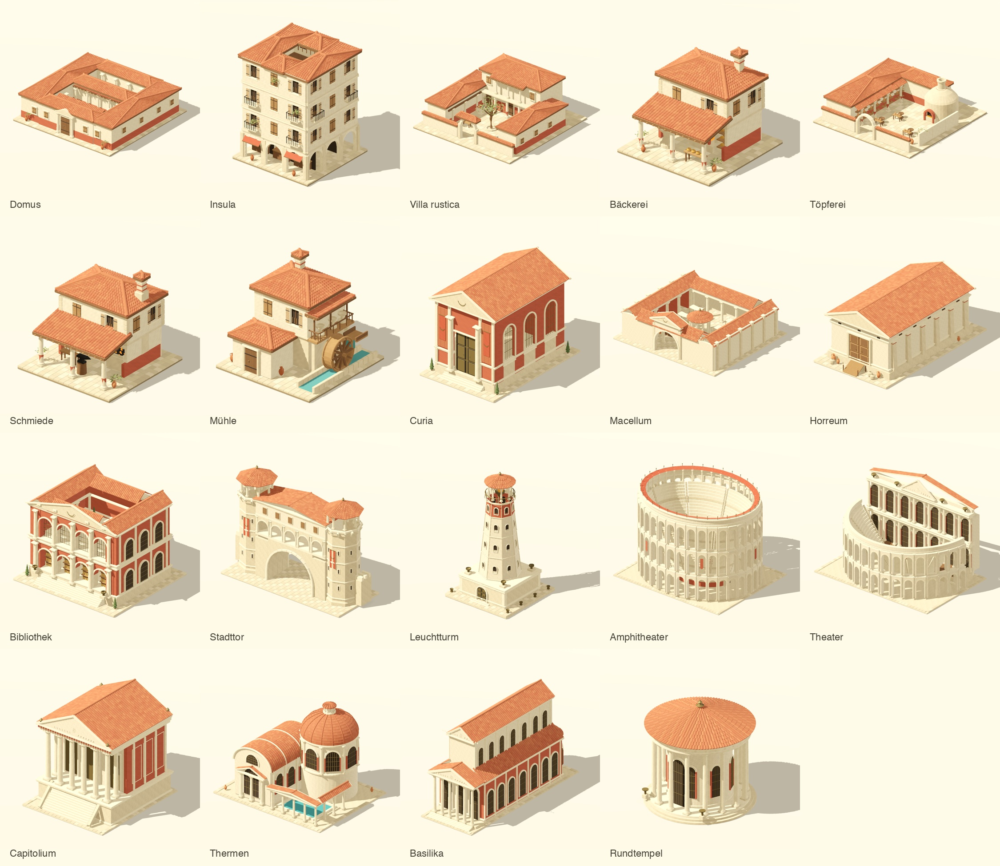

# Römische Bildserie – 19 zusätzliche Spielmodelle

Stand: validiert; Integrationsnachweis siehe `docs/handover/roman-series/validation.md`.

Die bestehende Serie von 20 isometrischen Vorlagen wird durch 19 eigene Blender-/GLB-Modelle ergänzt. Die bereits akzeptierte Taverna bleibt separat erhalten. Es sind echte 3D-Szenen im laufenden Spiel, keine flachen Bildtafeln. Geometrie, Oberflächen und eingebettete Texturen werden durch die eigenen Python-Buildskripte erzeugt; keine fremden Spielassets.

[Spielansichten und Prüfung](../handover/roman-series/validation.md)

## Im Spiel öffnen

`scripts/play-roman-building amphitheater` startet das normale Spiel direkt am Gebäude. `scripts/play-roman-building --list` zeigt die verfügbaren Kennungen; beispielsweise `domus`, `macellum` oder `leuchtturm`. `scripts/play-taverna` bleibt erhalten.

## Standorte

Die fünf Verona-Monumente ersetzen ihre vorhandenen Wahrzeichen. Horreum und Pharos verwenden ihre bereits bezeichneten Standorte. Die übrigen Plätze sind ausdrücklich künstlerische typologische Ergänzungen auf vorhandenen Parzellen, keine Behauptung historischer Adressen oder archäologischer Rekonstruktionen. Atlas, Simulation, Haushalte, Küste und Strassenverlauf werden nicht verändert. Die vollständigen Annahmen stehen im Platzierungsmanifest.

| Modell | Stadt | Parzellen (absolut x, y; Breite × Tiefe) |
|---|---|---|
| Amphitheater (`amphitheater`) | verona | 18457, 6923; 3 × 3 |
| Theater (`theater`) | verona | 18461, 6914; 3 × 2 |
| Capitolium (`capitolium`) | verona | 18464, 6918; 2 × 2 |
| Thermen (`thermen`) | verona | 18455, 6917; 3 × 2 |
| Basilika (`basilika`) | verona | 18464, 6920; 2 × 4 |
| Bäckerei (`baeckerei`) | verona | 18456, 6919; 1 × 1 |
| Schmiede (`schmiede`) | verona | 18456, 6921; 1 × 1 |
| Insula (`insula`) | verona | 18458, 6921; 1 × 1 |
| Mühle (`muehle`) | verona | 18461, 6919; 1 × 1 |
| Domus (`domus`) | trier | 16995, 5005; 2 × 2 |
| Villa rustica (`villa_rustica`) | alexandria | 24816, 13254; 2 × 2 |
| Töpferei (`toepferei`) | alexandria | 24809, 13257; 2 × 2 |
| Macellum (`macellum`) | alexandria | 24811, 13250; 3 × 3 |
| Bibliothek (`bibliothek`) | alexandria | 24814, 13251; 2 × 2 |
| Curia (`curia`) | trier | 17000, 5005; 2 × 2 |
| Horreum (`horreum`) | rome | 18955, 8502; 1 × 2 |
| Leuchtturm – Pharos (`leuchtturm`) | alexandria | 24801, 13248; 1 × 1 |
| Rundtempel (`rundtempel`) | rome | 18966, 8498; 1 × 1 |
| Stadttor (`stadttor`) | trier | 16999, 4999; 3 × 1 |

## Integration und Massstab

`app/scripts/buildings/roman_series.gd` lädt GLBs asynchron, sobald ihre Stadt in der Nähe liegt. Erst ein erfolgreich installiertes Modell verdrängt die alte Darstellung. Fehlende Assets lassen die alte Darstellung verfügbar. Ein erneuter Besuch verwendet das bereits geladene Modell. Die 19 Assets bleiben nach dem ersten Besuch im Speicher; es gibt noch keine Entladung bei Städtereisen.

`roman_series_building.gd` erhält Texturen, Albedo, Rauheit, Metall und Emission. Blender-Z wird korrekt in Godot-Y umgesetzt. Alle drei Achsen verwenden denselben Faktor: `DIORAMA_KM_PER_M` mit einem einheitlichen Anpassungsfaktor, falls das gesamte Modell samt Sockel nicht auf 94 % seines bestehenden Planrechtecks passt. Es gibt keine unabhängige Achsenverzerrung. Dies ist eine Parzellenanpassung der typologischen Vorlagen, keine neue historische Massberechnung nach S136; die bestehenden Verona-Planrechtecke bleiben erhalten.

Die vorhandene Terrain-Terrasse bleibt für Wahrzeichen erhalten. Andere Modelle folgen der höchsten Terrain-Ecke ihrer Parzellen; mehrzellige Höfe bekommen eine durchgehende Sockelwand bis zur niedrigsten Ecke. Eine Häusergruppe ersetzt nur die Darstellung ihrer Parzellen, ihre Simulationsidentitäten bleiben bestehen.

## Detailstufen

Die 19 Serienmodelle verwenden seit der Verona-Weiterentwicklung drei formbewahrend erzeugte Geometriestufen (`shape_preserving_v1`). Die bisher nötigen Detail-/Medium-Ersatzstufen entfallen. Mauern, Dachflächen und Bögen bleiben erhalten; kleine Verzierungen und Dachziegel werden gezielt reduziert. Die automatische zusätzliche Godot-LOD-Generierung ist für diese GLBs deaktiviert. Es ist stets genau eine Stufe sichtbar; die Fernstufe verzichtet auf Schatten. Bei gröberen Landschaftsstufen übernimmt der bestehende Stadt-Renderer.

Verona enthält zusätzlich drei Wohnhausvarianten und zwei wiederverwendbare Strassenmodelle. [Standorte, Regeln und Prüfungen](VERONA_CITY.md).

## Reproduzieren

- `tools/buildings/build_monuments.py`: Amphitheater, Theater, Capitolium, Thermen, Basilika, Rundtempel.
- `tools/buildings/build_houses_crafts.py`: Domus, Insula, Villa rustica, Bäckerei, Töpferei, Schmiede, Mühle.
- `tools/buildings/build_civic.py`: Curia, Macellum, Horreum, Bibliothek, Stadttor, Leuchtturm.
- Gemeinsame Geometrie, Materialien und Export: `tools/buildings/roman_asset_kit.py`.
- Blender-Aufruf: `Blender --background --factory-startup --python tools/buildings/build_civic.py -- --all` (entsprechend für die anderen Gruppen).
- GLBs und Messdaten: `app/assets/buildings/<id>/`; bearbeitbare Blender-Dateien: `build/roman-series/<id>/`.
- Platzierung: `app/assets/buildings/roman_series_placements.json`.
